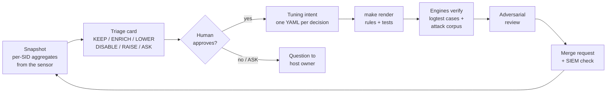

# suricata-tuning-agents

[](https://github.com/insomn1a0/suricata-tuning-agents/actions/workflows/ci.yml)

An agent-assisted, evidence-first workflow for tuning **Suricata → Wazuh** alerts: cut the noise analysts
see every day **without hiding attacks** - and prove it with tests.

A default ET ruleset on a corporate network produces hundreds of alerts a day, most of them "true but useless".
The usual fix - suppress whatever is loud - quietly creates blind spots. This kit replaces it with a process:

- every alert type gets one question: **"what does the analyst do when this fires?"**;
- hiding happens only in an **exact, verified context** (SID + host + port), never by volume;
- every change is **verified on the real engines** (Wazuh logtest, Suricata on pcaps) against a corpus of attacks
  that must stay visible;
- every claim carries an **evidence label** - nothing is called "tested" unless it ran.

**The model stays out of the alert path.** Claude Code agents work offline, like a careful colleague preparing
configuration changes: they propose, a human decides, deterministic engines verify. What the tests and
adversarial reviews caught along the way is in [`docs/WRITEUP.md`](docs/WRITEUP.md).

## One example

`ET INFO SMB2 NT Create AndX Request For an Executable File` (2025701) fires 214 times a day in the demo - 90% of
it workstations reading installers from the software distribution share. The triage card
([`examples/cards/2025701.md`](examples/cards/2025701.md)) splits it by context: **LOWER** on `files01:445`,
**ENRICH** on the domain controllers (visible once an hour, says what to verify), **KEEP** everywhere else -
an exe copied to *another workstation's* admin share is lateral tool transfer (T1570).

Each decision is a backend-neutral **intent** ([`tuning/intents/`](tuning/intents/)):

```yaml
id: smb-exe-distribution-share
action: lower
sids: [2025701]
routes:
  - dst: 10.10.20.15        # files01, software distribution share
    dst_port: 445
level: 3
risk: A malicious exe planted on the share and run by clients looks identical. The event stays in archives.
compensating_control: FIM on the Deploy share.
```

`make render` turns intents into Wazuh 4.x rules, Suricata `threshold.config`/`disable.conf`, an experimental
Wazuh 5 (Sigma) rule set ([`wazuh5/GAPS.md`](wazuh5/GAPS.md)) and the tests: positives plus the negatives that
must stay visible - neighbour SIDs, look-alike addresses, reverse direction, other ports, crossed routes.

<!-- metrics:start (generated by tools/metrics.py - do not edit) -->

Demo week, analyst-visible level >= 6 (2 intents; rule model verified by the generated logtest cases):

| SID | Signature | Alerts/day | Visible/day before | Visible/day after |
|---|---|---|---|---|
| 2025701 | ET INFO SMB2 NT Create AndX Request For an Executable File | 213.9 | 213.9 | 3.6 |
| 9900001 | EXAMPLE DNS Query to Advertising/Tracking Domain | 120.0 | 120.0 | 120.0 |
| 2025709 | ET INFO SMB2 NT Create AndX Request For a DLL File | 28.6 | 28.6 | 28.6 |
| 9900002 | EXAMPLE TLS SNI of Remote Administration Tool Relay | 5.0 | 5.0 | 5.0 |
| 9900003 | EXAMPLE HTTP Basic Authorization over Cleartext | 50.0 | 0.0 | 0.0 |
| **all** | | **417.4** | **367.4** | **157.1** (-57%) |

Lateral tool transfer in the demo data (exe to a workstation admin share): 3/3 events still visible after tuning.
Regression corpus: 4 attack cases (T1003.006, T1071.001, T1071.004, T1570); CI job `no-attack-lost` requires every one visible after tuning on Suricata + Wazuh, and every mutant intent to break that.

<!-- metrics:end -->

## How it works



Five agents (`.claude/agents/`) and five procedures (`.claude/skills/`: onboarding, sid-triage, tuning-change,
sensor-change, siem-query) - roles, models and decision classes in [`docs/PROCESS.md`](docs/PROCESS.md). It is all
plain Markdown, readable and reusable without any AI.

## What is proven

Generated tests check that a rule does what its intent says - not that the decision is right. That is the job
of the **regression corpus** ([`tests/corpus/`](tests/corpus/)): synthetic attacks (DCSync, an exe to another
workstation's admin share, a beacon, DNS tunnelling) and the benign traffic around them go through Suricata and
then Wazuh with the generated rules. Every attack must stay visible. **Mutants** - plausible but wrong intents
that pass every static check - must make that fail:

```
FAIL smb-exe: exe copied to another workstation's admin share: expected visible, got rule 100229 level 3 hidden
mutant killed: tests/corpus/mutants/lower-admin-workstation.yaml
```

| Suite | What it proves | Runs |
|---|---|---|
| `lint`, `test-unit` | rule hygiene, generated files current, lab data only; intents, renderer, guard (~250 cases + fuzzing) | CI |
| `test-logtest` | which Wazuh rule is *actually selected*, level, alert flag | CI, Wazuh 4.14.9 |
| `test-pcap` | signatures fire / stay silent on real packets, per session | CI, Suricata 8.0.8 |
| `test-e2e`, `test-e2e-mutant` | corpus → Suricata → Wazuh: attacks visible, noise hidden; every mutant caught | CI |
| `test-et-open` | the same with the real ET Open signatures (downloaded, never committed) | CI |
| `test-sensor-ro` | the sensor-side ForceCommand, executed for real: reads work, nothing on the sensor changes | CI |
| `evals` | the agents' judgement on five PLAYBOOK lessons (LLM-graded, opt-in) | manual |

Images are pinned by digest; versions live in `tools/kitconfig.py`. A lab pass is labelled `logtest <version>` /
`pcap-lab <version>` / `sensor-lab <version>` and does not prove behaviour on another version or traffic mix.

## Quick start

```bash
git clone https://github.com/insomn1a0/suricata-tuning-agents && cd suricata-tuning-agents
make demo                     # synthetic two weeks -> snapshots -> diff; no sensor, no Docker
make venv lint test-unit      # PyYAML for intents; static checks
make test-logtest test-pcap test-e2e test-e2e-mutant   # engines in throwaway containers (--network none)
```

**On your own sensor** you need a read-only ssh account (key-based), Docker and
[Claude Code](https://docs.claude.com/en/docs/claude-code/overview). Clone the repo and run `claude` in it, or
install it as a plugin in an empty directory (`/plugin marketplace add insomn1a0/suricata-tuning-agents`, then
`/plugin install suricata-tuning@suricata-tuning-agents`). Onboarding interviews you, writes the git-ignored
`config/environment.env` and `inventory/hosts.md`, checks access read-only and takes the first snapshot.

## Safety

Agents propose; humans decide anything that reduces visibility ([`docs/SAFETY.md`](docs/SAFETY.md)).

- **On the laptop**, a PreToolUse hook checks every tool call: no writes to the sensor, nothing internal to the web,
  no secrets in files; commit, push and sensor changes go to the user. It fails closed.
- **On the sensor**, an ssh ForceCommand ([`deploy/sensor/`](deploy/sensor/README.md)) runs only bounded reads -
  no shell, a flag allowlist per command - whatever the laptop sends. Six adversarial review rounds shaped it.
- Raw telemetry never leaves the sensor: the snapshot ships per-SID aggregates; real snapshots, cards and
  inventory are git-ignored.

## Limitations

- The data is synthetic and the kit has not run against a production sensor yet.
- The corpus proves that tuning keeps an attack visible when the signature fires, not that a ruleset detects it.
- Wazuh 5 output is experimental: 5.0 is at rc2, so it is checked by a rule model, not by a 5.x engine.
- The README metrics come from the rule model that the logtest cases verify (a replayed week cannot reproduce
  `ignore` windows in logtest).
- The laptop guard reads command lines, not what a local script does - the boundary is on the sensor.

## Roadmap

- Behavioural analytics over EVE `flow`/`krb5`/`dns` (Kerberoasting, password spraying, lateral fan-out).
- Run the Wazuh 5 output on a 5.x engine once 5.0 is GA.
- Sensor health check (capture drops, stale EVE, failed rule updates) as a Wazuh command monitor.

[CHANGELOG](CHANGELOG.md) · [CONTRIBUTING](CONTRIBUTING.md) · [SECURITY](SECURITY.md) · MIT license
