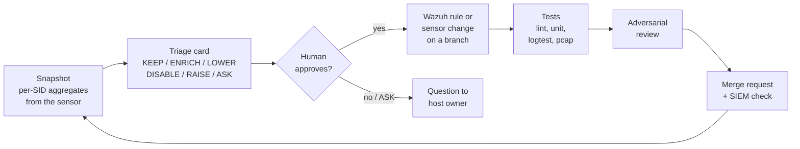

# suricata-tuning-agents

[](https://github.com/insomn1a0/suricata-tuning-agents/actions/workflows/ci.yml)

An agent-assisted, evidence-first workflow for tuning **Suricata → Wazuh** alerts: cut the noise analysts
see every day **without hiding attacks** - and prove it with tests.

Open-source NIDS is easy to install and hard to live with. A default ET ruleset on a corporate network
produces hundreds of alerts a day, most of them "true but useless". The usual fix - suppress whatever is
loud - quietly creates blind spots. This kit replaces that with a repeatable process run by a small team of
Claude Code agents, with hard safety limits:

- every alert type gets one question: **"what does the analyst do when this fires?"**;
- hiding happens only in an **exact, verified context** (SID + host + port), never by volume;
- every change ships with **positive and negative tests** run on the real engines (Wazuh logtest, Suricata on pcaps);
- every claim carries an **evidence label** - nothing is called "tested" unless it ran.

## How it works



| Agent | Model | Job |
|---|---|---|
| `sensor-collector` | haiku | read-only facts from the sensor - aggregates only, never raw events |
| `noise-analyst` | sonnet | writes a triage card per SID: evidence, hypothesis, one decision |
| `validator` | haiku | runs the test suites, reports raw PASS / FAIL / NOT_RUN |
| `reviewer` | opus | tries to break a batch before MR: crossed pairs, prefix IPs, sibling selection |
| `scout` | sonnet | weekly: snapshot trends, disappeared SIDs, ATT&CK gaps, unused engine features |

Procedures are skills (`.claude/skills/`): **`onboarding`** (interviews you and adapts the kit to your
sensor, Wazuh version, alert level, rule ID range, working hours and autonomy level), `sid-triage`,
`tuning-change`, `sensor-change`, `siem-query`. The whole method is plain Markdown, so it is also
readable - and reusable - without any AI.

## Decision classes

| Class | When | Implemented as |
|---|---|---|
| `KEEP` | actionable as is | - |
| `ENRICH` | actionable, but the alert doesn't say what to check | better description / level / rate limit |
| `LOWER` | empty in an exact, verified context | Wazuh child rule below the visible level (event stays in archives) |
| `DISABLE` | no value anywhere (parser/decoder noise) | `disable.conf` on the sensor |
| `RAISE` | hidden, but a human should look | Wazuh child rule at the visible level |
| `ASK` | needs the owner's knowledge | a precise question in the card |

## Worked example (synthetic lab data)

`ET INFO SMB2 NT Create AndX Request For an Executable File` (2025701) is a classic: 214 alerts/day in the
demo, 90% of them workstations opening installers on a software distribution share.
The card [`examples/cards/2025701.md`](examples/cards/2025701.md) splits it by context:

- distribution share `files01` + :445 → **LOWER** (rule 100220);
- domain controllers (GPO/logon scripts) → **ENRICH**: visible, says what to verify, max one per hour (100221);
- an exe copied to *another workstation's* admin share → **KEEP** - that is lateral tool transfer (T1570).

Each decision is a backend-neutral **intent** ([`tuning/intents/`](tuning/intents/), schema in
[`tuning/schema.json`](tuning/schema.json)):

```yaml
id: smb-exe-distribution-share
action: lower
sids: [2025701]
routes:
  - dst: 10.10.20.15        # files01, software distribution share
    dst_port: 445
level: 3
risk: A malicious exe planted on the share and run by clients looks identical. The event stays in archives.
compensating_control: FIM on the Deploy share.
wazuh: {parent: 100206, rule_ids: [100220]}
tests: {neighbour_sids: [2025709]}
```

`make render` turns intents into Wazuh 4.x XML (`wazuh/rules/100220-suricata_tuning.xml`), Suricata
`threshold.config`/`disable.conf`, and logtest cases derived from the intent: neighbour SIDs, prefix addresses
on both sides, reverse direction, other port, crossed route pairs. Wazuh 5 drops XML rules; its adapter is a
stub until the format is GA - the intents need no change.

```xml
<rule id="100220" level="3">
  <if_sid>100206</if_sid>
  <field name="alert.signature_id" type="pcre2">^2025701$</field>
  <field name="dest_ip" type="pcre2">^10\.10\.20\.15$</field>
  <field name="dest_port" type="pcre2">^445$</field>
  <description>SMB executable open on software distribution share $(dest_ip) from $(src_ip)</description>
</rule>
```

The interesting part is what must **not** be lowered - [`tests/logtest/smb-tuning.expect`](tests/logtest/smb-tuning.expect):

| Case | Expected |
|---|---|
| exe from a workstation to `10.10.20.15:445` | 100220, level 3, hidden |
| same server, DLL signature (neighbour SID) | 100206, visible |
| same server, port 139 / reverse direction | 100206, visible |
| `10.10.20.150` (prefix of the lowered IP) | 100206, visible |
| exe to a workstation admin share | 100206, visible |
| alert without `confidence` metadata | stock 86601 only |
| DC: first event / repeat within the hour | 100221 visible / archived |

Estimated effect on the demo data: this SID 214 → ~2.5 visible alerts/day; all visible Suricata alerts 367 → ~156/day (-57%).

A local signature is handled the same way: [`suricata/rules/local.rules`](suricata/rules/local.rules) detects
**DCSync** (DRSUAPI `GetNCChanges` from a non-DC, T1003.006) and is proven on a generated pcap:
workstation opnum 3 alerts; `DRSCrackNames` (opnum 12) and DC→DC replication do not.

## No attack lost

Tests generated from an intent can only check that the rule does what the intent says. They cannot tell that
the decision itself is wrong. That is what the regression corpus is for ([`tests/corpus/`](tests/corpus/)):
synthetic attacks - DCSync, an exe copied to another workstation's admin share, a periodic beacon, DNS
tunnelling - plus the benign traffic around them, generated as pcaps by a stdlib script. `make test-e2e` replays
them through Suricata, sends the alerts through Wazuh logtest with the **generated** rules and checks
`siem.yaml`: every attack visible, the noise hidden.

```
attacks visible 4/4, noise hidden 1/1, context as expected 1/1
```

`tests/corpus/mutants/` holds plausible but wrong intents - "lower the admin workstation's pushes to the
'staging host'", "lower everything to the internal resolver", "suppress the admin workstation on the sensor".
Each passes the schema, the semantic checks and its own generated tests. `make test-e2e-mutant` requires each
one to make the corpus fail:

```
FAIL smb-exe: exe copied to another workstation's admin share: expected visible, got rule 100229 level 3 hidden
mutant killed: tests/corpus/mutants/lower-admin-workstation.yaml
mutant killed: tests/corpus/mutants/lower-internal-resolver.yaml
mutant killed: tests/corpus/mutants/suppress-admin-workstation.yaml
```

The suppress mutant first *survived*: the generated `threshold.config` put a comment at the end of the line,
Suricata rejected the line with a parse error and silently dropped the suppression. The renderer and the
runner were fixed (engine errors now fail the run) - a deployment would have carried a suppression that did
nothing.

## Quick start

```bash
git clone https://github.com/insomn1a0/suricata-tuning-agents && cd suricata-tuning-agents
make demo         # synthetic two weeks -> snapshots -> diff; no sensor, no Docker
make venv          # PyYAML for tuning intents (sensor-side tools stay stdlib)
make lint test-unit
make test-logtest # Wazuh logtest in a throwaway container (--network none)
make test-pcap    # Suricata on the corpus pcaps in a throwaway container
make test-e2e test-e2e-mutant   # corpus -> Suricata -> Wazuh: no attack lost; bad intents are caught
```

`make demo` shows what the `scout` agent looks at every week:

```
alerts 2922 -> 2818, visible 2572 -> 2818, sids 5 -> 5
NEW SIDs (1):
     9100001 L13      0.1/d LOCAL Possible DCSync - DRSUAPI DRSGetNCChanges from non-DC
DISAPPEARED SIDs (1) - if they were steady, check for breakage:
     9900003 L3      50.0/d days_seen_before=7 EXAMPLE HTTP Basic Authorization over Cleartext
SPIKES / DROPS x5 (1):
     9900002 L8       5.0/d -> 40.0/d EXAMPLE TLS SNI of Remote Administration Tool Relay
```

### On your own sensor

Requirements: a read-only ssh account on the sensor (key-based, `BatchMode`), Docker for the engine tests,
[Claude Code](https://docs.claude.com/en/docs/claude-code/overview).

Either clone the repo and run `claude` in it (CLAUDE.md starts onboarding on first run), or install it as a
Claude Code plugin in an empty working directory:

```
/plugin marketplace add insomn1a0/suricata-tuning-agents
/plugin install suricata-tuning@suricata-tuning-agents
```

then ask for onboarding: it copies the kit's working files (tools, rules, tests, CLAUDE.md) into the
directory first. Use one mode or the other - a clone with the plugin installed loads every skill twice.

Onboarding asks about your environment, writes `config/environment.env` and `inventory/hosts.md`
(both git-ignored), verifies access and versions read-only, takes the first snapshot and opens the journal.

## Safety model

Agents propose; humans decide anything that reduces visibility. Details: [`docs/SAFETY.md`](docs/SAFETY.md).

- Sensor access is read-only, and that is **enforced**, not just instructed: a PreToolUse hook
  ([`.claude/hooks/guard.py`](.claude/hooks/guard.py)) blocks writes, restarts, installs and redirects over ssh,
  asks the user about anything not on a read-only allowlist, routes commit/push/merge to the user, and blocks
  internal identifiers to the web and secrets written into files. It fails closed. Writes need the
  `sensor-change` skill, an explicit yes, a backup and a rollback command.
- Raw telemetry never leaves the sensor: the snapshot ships per-SID aggregates only.
- Nothing internal is sent to web search or external services.
- Real snapshots, cards, inventory and journal are git-ignored; `lint_rules.py` rejects literal IPs in
  descriptions, unanchored regexes and tuning rules that don't pin a SID.

## Repository layout

```
.claude/agents/      role prompts (5 agents); agents -> .claude/agents for the plugin
.claude/skills/      procedures: onboarding, sid-triage, tuning-change, sensor-change, siem-query
.claude/hooks/       guard.py (PreToolUse), hooks.json for the plugin; settings.json registers it for a clone
.claude-plugin/      plugin and marketplace manifests
config/ inventory/   templates for your environment (real files are git-ignored)
docs/                PROCESS, PLAYBOOK (lessons), SAFETY
templates/           triage card, work journal
tools/               snapshot, diff, lint, lab-data guard, config, logtest runner, pcap runner
tuning/              intents (one YAML per decision) + schema; the source of every tuning rule
wazuh/rules/         severity x confidence ladder + GENERATED tuning rules (registry in wazuh/README.md)
suricata/rules/      local signatures (DCSync)
tests/               logtest specs (hand + generated), corpus (pcaps, suricata-verify style checks, mutants), unit
examples/            synthetic data generator, worked triage card
```

## Evidence and test status

| Suite | What it proves | Runs |
|---|---|---|
| `lint` | rule hygiene, ID range, parents exist, anchoring; tracked files contain lab data only | CI, no Docker |
| `test-unit` | snapshot aggregation, diff, intents and renderer, corpus pcaps current and well-formed, config parsing, lab-data guard, PreToolUse guard (~250-case table, fuzzing, hook contract) | CI (Python 3.10, 3.12) |
| `test-logtest` | which Wazuh rule is *actually selected*, level, alert flag; fails on any analysisd ERROR/WARNING | CI, `wazuh/wazuh-manager:4.14.9` |
| `test-pcap` | corpus `test.yaml` checks: signatures fire / stay silent on real packets, per session | CI, `jasonish/suricata:8.0.8` |
| `test-e2e` | corpus → Suricata → Wazuh with the generated rules: every attack visible, noise hidden | CI, both images |
| `test-e2e-mutant` | each plausible-but-wrong intent in `tests/corpus/mutants` makes `test-e2e` fail | CI, both images |

Engine versions have one source, `tools/kitconfig.py` (overridden by `config/environment.env`, then by the
environment: `make test-logtest WAZUH_VERSION=4.14.8`). The tests were checked by mutation: un-anchoring the
lowered IP or matching the wrong DCE/RPC opnum makes them fail.

A pass in the lab is labelled `logtest <version>` / `pcap-lab <version>`; it does not prove behaviour on a
different production version, ruleset or traffic mix.

## Limitations

- The snapshot's predicted level models only the severity ladder (100200-100206), not tuning children -
  confirm final rule IDs with a SIEM aggregation (`siem-query`).
- Example data is synthetic; numbers show the method, not a production result.
- The DCSync signature sees DCE/RPC over TCP; encrypted SMB3 transport is out of its sight.

## Roadmap

- Behavioural analytics over EVE `flow`/`krb5`/`dns` (Kerberoasting, password spraying, DNS tunnelling,
  lateral fan-out) with logtest-tested Wazuh rules.
- Sensor health check (capture drops, stale EVE, failed rule updates) as a Wazuh command monitor.
- ATT&CK Navigator layer generated from enabled rules + observed alerts.
- Threat-intel IOC feed → Suricata rules with stable SIDs and an allowlist for shared platforms.

## License

MIT
